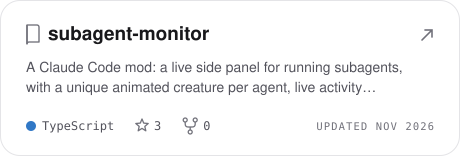
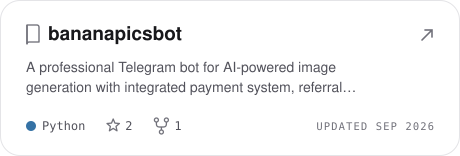
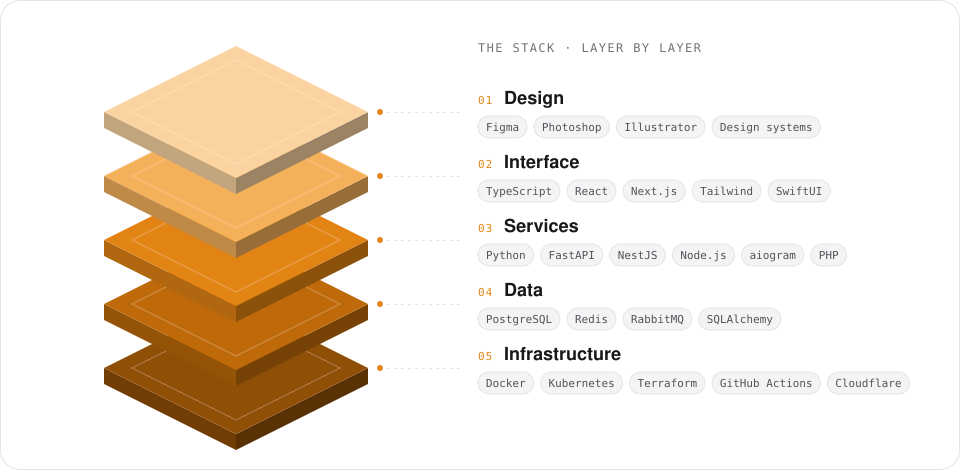
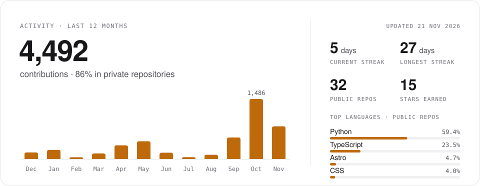

<picture>
  <source media="(prefers-color-scheme: dark)" srcset="assets/banner-dark.svg">
  
</picture>

  
  
  
  
  

### About

I'm a product engineer from Tashkent. I take products from the first sketch in Figma to a running system in production: interfaces and design systems, web apps, backends, infrastructure and Telegram bots.

- Building and running **[Payzone](https://payzone.uz)** — microservices on FastAPI, Next.js and Kubernetes
- Designing **TAVRYN**, a calm planner for iOS, and learning Swift and SwiftUI along the way
- Working with AI agents every day, and building tools for them, like [subagent-monitor](https://github.com/blogchik/subagent-monitor)
- Open to interesting product collaborations

### What I'm building

  <a href="https://payzone.uz"><picture>
    <source media="(prefers-color-scheme: dark)" srcset="assets/project-payzone-dark.svg">
    
  </picture></a>
  <a href="https://karimovacademy.uz"><picture>
    <source media="(prefers-color-scheme: dark)" srcset="assets/project-karimov-academy-dark.svg">
    
  </picture></a>

  <picture>
    <source media="(prefers-color-scheme: dark)" srcset="assets/project-tavryn-dark.svg">
    
  </picture>
  <picture>
    <source media="(prefers-color-scheme: dark)" srcset="assets/project-ezdonation-dark.svg">
    
  </picture>

### Open source

  <a href="https://github.com/blogchik/subagent-monitor"><picture>
    <source media="(prefers-color-scheme: dark)" srcset="https://raw.githubusercontent.com/blogchik/blogchik/output/repo-subagent-monitor-dark.svg">
    
  </picture></a>
  <a href="https://github.com/blogchik/bananapicsbot"><picture>
    <source media="(prefers-color-scheme: dark)" srcset="https://raw.githubusercontent.com/blogchik/blogchik/output/repo-bananapicsbot-dark.svg">
    
  </picture></a>

  <a href="https://github.com/blogchik/bitrix24-widget-callanalytics"><picture>
    <source media="(prefers-color-scheme: dark)" srcset="https://raw.githubusercontent.com/blogchik/blogchik/output/repo-bitrix24-widget-callanalytics-dark.svg">
    
  </picture></a>
  <a href="https://github.com/blogchik/my-website"><picture>
    <source media="(prefers-color-scheme: dark)" srcset="https://raw.githubusercontent.com/blogchik/blogchik/output/repo-my-website-dark.svg">
    
  </picture></a>

### Tech stack

<picture>
  <source media="(prefers-color-scheme: dark)" srcset="assets/stack-dark.svg">
  
</picture>

### GitHub activity

<picture>
  <source media="(prefers-color-scheme: dark)" srcset="https://raw.githubusercontent.com/blogchik/blogchik/output/stats-dark.svg">
  
</picture>

<picture>
  <source media="(prefers-color-scheme: dark)" srcset="https://raw.githubusercontent.com/blogchik/blogchik/output/snake-dark.svg">
  
</picture>

<picture>
  <source media="(prefers-color-scheme: dark)" srcset="assets/footer-dark.svg">
  
</picture>

  
  
  
  
  

  
  

